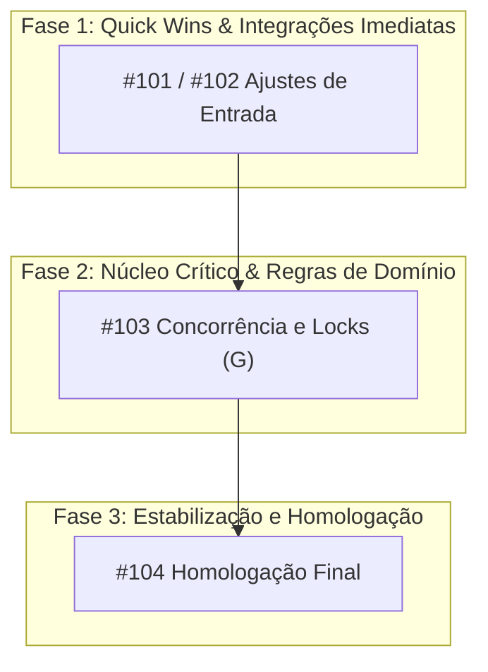

# Pace Keeper — Guardião de Ritmo, Capacidade e Prazos de Entrega

Esta skill estabelece o método determinístico para calcular a velocidade de desenvolvimento necessária para atingir datas limite (deadlines) em projetos de software, integrando auditoria de backlog, caminho crítico, capacidade líquida de dias úteis, totalizadores de entregas e governança estratégica.

---

## 1. Objetivo

Converter prazos de entrega fixos e escopos de software (gerenciados via GitHub Projects/Issues, diretórios de tarefas em Markdown ou especificações SDD) em métricas práticas e auditáveis:
- Quantidade necessária de tarefas ou pontos por dia útil e dia corrido (total do time e individual por analista).
- Segregação e totalização de entregas em issues macro e subtarefas atômicas de implementação/teste.
- Identificação do caminho crítico e marcos de corte (drop-dead dates).
- Cronograma tático de execução para evitar estrangulamento da esteira.
- Governança integrada com pontos de atenção para o Tech Leader, GP/PM e outros analistas.
- Geração automática do relatório em formato duplo: Markdown e HTML standalone com CSS embutido.

---

## 2. Princípios e Regras

1. **Sem Suposições:** A velocidade necessária deve ser fundamentada no estado factual do repositório, branches, commits e quadro de tarefas.
2. **Sondagem Prévia Obrigatória:** Se os parâmetros fundamentais de projeto, board, milestone, prazo e equipe não estiverem claros na solicitação inicial, o agente deve obrigatoriamente fazer as perguntas de alinhamento antes de calcular.
3. **Reserva Obrigatória de Buffer:** Nunca planejar desenvolvimento ativo até o último minuto do prazo. Reservar de 1 a 1,5 dias úteis finais para homologação em staging, testes de carga/regressão e preparação de release (Code Freeze).
4. **Qualidade Inviolável:** A velocidade calculada não autoriza corte de testes unitários, testes de integração reais ou violação das regras de arquitetura. Atalhos técnicos são tratados como débitos com custo futuro.
5. **Comunicação Direta:** Redação técnica e clara em Português do Brasil (pt-BR), sem emojis ou ícones excessivos no texto corrido.
6. **Formatação Estrita do Cronograma Tático:** Na tabela da Seção 5, a coluna `Dia / Data` deve obrigatoriamente ter o espaço após o número do dia e o dia da semana invertido com a data numérica: `"Dia X (DiaSemana) DD/MM"` (exemplo: `"Dia 1 (Qua) 14/10"`). É terminantemente proibido concatenar os dados sem espaço (ex.: nunca gerar `"Dia 114/10 (Qua)"`).
7. **Ordem de Execução Sequencial das Issues:** Na coluna `Issues Alocadas` da Seção 5, as issues alocadas para cada dia devem ser listadas estritamente na ordem de execução técnica/dependência, utilizando a representação sequencial com separador ` > ` (exemplo: `#101 > #123 > #325`). Não criar seções adicionais para isso; a representação fica diretamente na célula da tabela.
8. **Segregação e Totalizadores de Entregas (Issues vs Sub-issues):**
   - *Issues Principais:* Demandas de negócio, histórias de usuário, épicos, bugs ou tickets pai do board (ex: `#101`, `TASK-202`, `PROJ-303`).
   - *Sub-issues / Subtarefas Atômicas:* Tarefas filhas técnicas, checklists em arquivos de especificação (ex: `- [ ]` em `tasks.md`, `subtask/#101.1`).
   - Apresentar totalizadores claros de itens concluídos, em andamento e pendentes.
9. **Tríade de Governança Estratégica:**
   Todo diagnóstico deve obrigatoriamente conter a Seção 6 estruturada em 3 frentes de governança:
   - *6.1 Pontos de Atenção para o Tech Leader* (arquitetura, concorrência, locks de banco, contratos de API e PRs críticos).
   - *6.2 Pontos de Atenção para o Gerente de Projetos (GP / PM)* (viabilidade do prazo, marcos de corte, propostas de desescopo cirúrgico e preservação de buffer).
   - *6.3 Notas para Outros Analistas* (alinhamento de handoff, frentes paralelas e prevenção de conflitos de merge. Se analista único, registrar: *"N/A — Analista único atuando na esteira."*).
10. **Entrega Dupla Obrigatória (Chat + Arquivos em Disco):**
    O relatório deve ser exibido integralmente em Markdown no chat e salvo em disco em duas versões:
    - Versão Markdown: `AAAAMMDD-pace-keeper-[nome-do-projeto]-[milestone].md`.
    - Versão HTML Standalone: `AAAAMMDD-pace-keeper-[nome-do-projeto]-[milestone].html` (gerada automaticamente pelo script `export_html.py`).

---

## 3. Perguntas Obrigatórias de Entrada (Sondagem Inicial)

Sempre que a skill for acionada e o usuário não tiver fornecido integralmente as informações de contexto na mensagem, o agente DEVE pausar e apresentar expressamente as seguintes perguntas de alinhamento:

```text
Para calcular a velocidade de desenvolvimento e a viabilidade do prazo com precisão, por favor informe:

1. Qual o projeto a ser analisado?
2. Qual a URL do board deste projeto no github?
3. Qual o Milestone do board a ser considerado?
4. Qual a data do próximo dead-line?
5. Quantos analistas estão atuando no projeto?
6. Quais colunas do board devem ser consideradas como entregas realizadas? (Ex.: Apenas Done? Ou Await Staging, In Staging e Done?)
```

### Como Utilizar Cada Resposta

1. **Qual o projeto a ser analisado?**
   - Determina o diretório-raiz de trabalho, a árvore de código, a arquitetura e os arquivos de especificação/tarefas (`docs/tasks/`, `docs/specs/`, `tasks.md`, `issues-trail.md`). Se o agente já estiver aberto na pasta do projeto, sugere o projeto local atual para confirmação.
2. **Qual a URL do board deste projeto no github?**
   - Aponta diretamente para a view do GitHub Projects (ex.: `https://github.com/orgs/<ORG>/projects/<NUM>/views/<VIEW>`).
   - Permite que o agente consulte os itens via GitHub CLI (`gh project item-list`), mapeie as colunas de status (`Backlog`, `Ready`, `In progress`, `In review`, `In Staging`, `Done`, `Blocked`) e audite o estado real dos cards.
3. **Qual o Milestone do board a ser considerado?**
   - Estabelece o filtro estrito de recorte de escopo da entrega (ex.: `milestone:"v1.0.0 - Envio via WhatsApp"`).
   - Isola as issues que compõem o compromisso imediato, descartando demandas de versões futuras.
4. **Qual a data do próximo dead-line?**
   - Fixa a data-alvo limite para o encerramento do desenvolvimento e entrega.
   - Serve de base para calcular dias corridos, dias úteis brutos, feriados no período e dias úteis líquidos (descontando o buffer de homologação).
5. **Quantos analistas estão atuando no projeto?**
   - Quantifica a capacidade instalada da equipe de desenvolvimento ($N_{analistas}$).
   - Viabiliza o cálculo da velocidade agregada do time e da velocidade individual exigida por profissional (throughput per capita), além de calibrar o paralelismo real da esteira.
6. **Quais colunas do board devem ser consideradas como entregas realizadas?**
   - Define a linha de corte (Definition of Done) para segregação precisa entre escopo concluído e escopo pendente.
   - Permite flexibilidade de acordo com o estágio do ciclo de vida: se apenas `Done` (em produção) é entrega, itens em homologação entram como pendência; se colunas como `Await Staging` e `In Staging` já representam código desenvolvido e mergeado em branch de integração, o esforço pendente recai estritamente sobre as colunas anteriores (`In progress`, `Ready`, `Refinement`, `Backlog`).

---

## 4. Modos de Operação

### Modo A: Integrado a GitHub Projects / Issues
Utilizado quando o projeto gerencia seu backlog pelo GitHub.
1. Inspecione o quadro via `gh project item-list <PROJECT_NUMBER> --owner <OWNER> --format json` (ou `gh issue list --milestone "<MILESTONE>"`).
2. Filtre os itens pelo milestone informado.
3. Separe os itens conforme as colunas de entrega informadas na pergunta 6:
   - Concluídos: cards nas colunas declaradas pelo usuário como entregues (ex.: `Done`, ou `Await Staging` + `In Staging` + `Done`).
   - Em andamento: cards em desenvolvimento ativo ou revisão (ex.: `In progress`, `In review`).
   - Remanescentes: cards pendentes de execução (ex.: `Backlog`, `Ready`, `Refinement`, `Blocked`).
4. Extraia o campo de estimativa/tamanho (P, M, G) ou prioridade (P1, P2, P3, P4) para quantificar o esforço pendente.
5. Inspecione se há arquivos de tarefas atômicas locais (ex: `specs/<slug>/tasks.md` ou `docs/tasks/`) vinculados às issues para quantificar as subtarefas atômicas.

### Modo B: Baseado em Arquivos Markdown Locais (Spec Kit / SDD)
Utilizado em projetos estruturados por especificações em pastas (ex: `docs/tasks/`, `docs/specs/`, `tasks.md`, `issues-trail.md`).
1. Inspecione o índice de tarefas e os arquivos de especificação da demanda/milestone.
2. Quantifique as tarefas macro e as subtarefas atômicas já concluídas (`- [X]`) versus pendentes (`- [ ]`).
3. Mapeie a matriz de dependências técnicas entre tarefas.

### Modo C: Entrada Paramétrica Direta
Utilizado quando o usuário fornece diretamente os números de tarefas por complexidade (P, M, G).
1. Colete as respostas das perguntas de entrada.
2. Execute o cálculo com o script utilitário da skill.

---

## 5. Metodologia de Cálculo

### 5.1 Janela Temporal e Dias Úteis Líquidos
- **Dias Corridos ($D_c$):** Diferença em dias corridos entre a data inicial e a data alvo.
- **Dias Úteis Brutos ($D_u$):** Dias de segunda a sexta-feira no intervalo, excluindo feriados oficiais (nacionais e locais).
- **Buffer de Homologação ($B$):** Desconto de 1,0 a 1,5 dias úteis para estabilização final em staging.
- **Dias Úteis Líquidos de Desenvolvimento ($D_{ul}$):**
  $$D_{ul} = \max(0.5, D_u - B)$$

### 5.2 Dimensionamento de Esforço
Caso o projeto utilize classificação por tamanho de tarefa, adote os seguintes pesos determinísticos:
- **P (Pequena):** 1 ponto (tarefas de configuração, contratos simples, ajustes pontuais de tela).
- **M (Média):** 2 pontos (casos de uso de domínio, endpoints com persistência, tabelas e migrações).
- **G (Grande):** 4 pontos (workers de segundo plano de alta complexidade, concorrência, integrações resilientes com provedores externos, refatorações amplas).
- **Tarefas sem tamanho definido:** Peso padrão 2 pontos.

### 5.3 Fórmulas de Velocidade (Throughput)
- **Velocidade Total do Time em Tarefas Macro ($V_t$):**
  $$V_t = \frac{\text{Total de Tarefas Pendentes}}{D_{ul}}$$
- **Velocidade Total do Time em Pontos de Esforço ($V_p$):**
  $$V_p = \frac{\text{Total de Pontos de Esforço}}{D_{ul}}$$
- **Velocidade Total do Time em Subtarefas Atômicas ($V_a$):**
  $$V_a = \frac{\text{Total de Subtarefas Atômicas Pendentes}}{D_{ul}}$$
- **Velocidade Individual por Analista:**
  $$V_{ind\_tarefas} = \frac{V_t}{N_{analistas}}, \quad V_{ind\_pontos} = \frac{V_p}{N_{analistas}}, \quad V_{ind\_subtarefas} = \frac{V_a}{N_{analistas}}$$

### 5.4 Script Auxiliar de Cálculo
A skill inclui uma ferramenta em Python para processar os cálculos automaticamente:
```bash
python3 /home/mmc/00_code/00_tools/_skills/pace-keeper/scripts/calculate_pace.py \
  --start-date AAAA-MM-DD \
  --target-date AAAA-MM-DD \
  --tasks-p QTD_P \
  --tasks-m QTD_M \
  --tasks-g QTD_G \
  --atomic-tasks QTD_SUBTAREFAS \
  --analysts QTD_ANALISTAS \
  --buffer-days 1.0
```

---

## 6. Mapeamento do Caminho Crítico e Gargalos

A velocidade matemática média só é válida se respeitar o grafo de dependências técnicas. Em todo diagnóstico:
1. **Identifique a Cadeia Sequencial Mais Longa:** O caminho de tarefas em que cada item depende obrigatoriamente do anterior (não paralelizável).
2. **Localize Itens de Tamanho G no Caminho Crítico:** Tarefas complexas no caminho crítico determinam a viabilidade do projeto.
3. **Calcule a Drop-Dead Date:** A data mais tardia em que o item crítico pode ser iniciado antes de inviabilizar a entrega.
4. **Explore Lotes Coexecutáveis:** Mapeie tarefas independentes que podem ser divididas entre os analistas disponíveis enquanto o caminho principal avança.

---

## 7. Estrutura do Relatório de Ritmo

Ao responder ao usuário e redigir o documento Markdown, apresente o diagnóstico organizado obrigatoriamente nas 6 seções abaixo:

```markdown
# Relatório de Ritmo e Capacidade de Entrega — [Nome do Projeto]

**Projeto Local:** [nome-da-pasta]  
**Repositório GitHub:** [[org/repo]](https://github.com/org/repo)  
**GitHub Projects:** [[Board #N (View X)]](https://github.com/orgs/org/projects/N/views/X)  
**Milestone:** [v1.0.0]  
**Data da Análise:** [DD/MM/AAAA]  
**Data Limite (Deadline):** [DD/MM/AAAA (DiaSemana)]  
**Capacidade Técnica:** [N Analistas]  
**Critério de Entrega:** [Done, Await Staging, In Staging]  

---

> [!IMPORTANT]
> **Resumo de Escopo e Viabilidade:** [Breve resumo do estado do milestone, principais decisões de escopo e factibilidade do prazo].

## 1. Diagnóstico da Janela Temporal e Capacidade Real
- Datas de início, deadline e feriados mapeados.
- Contagem de dias corridos, dias úteis brutos e dias úteis líquidos (com desconto do buffer de homologação).
- Capacidade da equipe: quantidade de analistas ativos.

| Parâmetro | Valor | Detalhamento |
| :--- | :---: | :--- |
| **Data Inicial (Hoje)** | DD/MM/AAAA | [Dia da semana] |
| **Data Alvo (Deadline)** | DD/MM/AAAA | [Dia da semana] de go-live / entrega |
| **Dias Corridos** | N dias | Intervalo total |
| **Dias Úteis de Calendário** | N dias | Segunda a sexta-feira |
| **Feriados no Período** | N dias | [Datas dos feriados ou 0] |
| **Buffer de Homologação / Staging** | 1,0 dia | Janela obrigatória de estabilização |
| **Dias Úteis Líquidos de Desenvolvimento** | N dias | Janela real para codificação ativa |
| **Analistas Ativos** | N analista(s) | Capacidade técnica disponível |

## 2. Estado do Backlog e Totalizadores de Entregas

### 2.1 Totalizadores de Entregas do Escopo
| Tipo de Demanda | Concluídas | Em Andamento | Pendentes | Total Escopo |
| :--- | :---: | :---: | :---: | :---: |
| **Issues Principais (Cards do Board)** | [N] | [N] | [N] | [N total] |
| **Sub-issues / Subtarefas Atômicas** | [N] | [N] | [N] | [N total] |
| **Total Consolidado de Demandas** | [N] | [N] | [N] | [N total] |

### 2.2 Distribuição por Colunas do Board
| Coluna / Status | Cards | Percentual | Classificação de Entrega |
| :--- | :---: | :---: | :--- |
| **Done** | [N] | [%] | Concluído em Produção |
| **In Staging** | [N] | [%] | Homologação Ativa (Entrega realizada) |
| **Await Staging** | [N] | [%] | PR Integrado na Develop (Entrega realizada) |
| **In review / In progress** | [N] | [%] | Em Desenvolvimento / Revisão Ativa |
| **Ready / Refinement / Backlog** | [N] | [%] | Escopo Pendente de Puxada |
| **Blocked** | [N] | [%] | Impedimento Ativo |

### 2.3 Dimensionamento de Complexidade e Esforço
| Tamanho / Complexidade | Peso | Quantidade | Pontos de Esforço | Perfil Técnico |
| :--- | :---: | :---: | :---: | :--- |
| **P (Pequena)** | 1 | [N] | [N] pts | Ajustes pontuais, textos, configs |
| **M (Média)** | 2 | [N] | [N] pts | Casos de uso, novos endpoints, regras |
| **G (Grande)** | 4 | [N] | [N] pts | Concorrência, workers, refatorações amplas |
| **Total Pendente** | — | [Total] | [Total] pts | Esforço líquido a executar |

## 3. Velocidade Necessária (Throughput Diário)
| Métrica de Throughput | Ritmo do Time Total | Ritmo Individual (Per Capita) | Interpretação e Factibilidade |
| :--- | :---: | :---: | :--- |
| **Cards / Dia Útil Líquido** | [X] cards/dia | [X/N] cards/dia | [Análise de factibilidade] |
| **Pontos de Esforço / Dia Útil Líquido** | [Y] pts/dia | [Y/N] pts/dia | [Análise de esforço sustentável] |
| **Subtarefas Atômicas / Dia Útil Líquido** | [Z] subtarefas/dia | [Z/N] subtarefas/dia | [Cadência diária de PRs/commits] |
| **Cards / Dia Corrido** | [W] cards/dia | — | [Ritmo contínuo calendário] |

## 4. Gestão do Caminho Crítico e Gargalos



### 4.1 Gargalos Críticos Restantes (Tamanho G)
| Issue / Gargalo | Tamanho | Natureza do Risco / Arquitetura | Drop-Dead Date |
| :--- | :---: | :--- | :---: |
| **#NNN — [Título da Issue]** | G (4 pts) | [Risco de arquitetura, banco, concorrência ou dependência externa] | DD/MM às HH:MM |

## 5. Cronograma Tático de Marcos

| Dia / Data | Foco Operacional e Módulos | Issues Alocadas | Meta Diária |
| :--- | :--- | :--- | :---: |
| **Dia 1 (Qua) 14/10** | [Módulo ou tema da esteira] | #262 > #297 > #118 > #190 > #282 > #216 | 8 cards |
| **Dia 2 (Qui) 15/10** | [Módulo ou tema da esteira] | #255 > #271 > #272 > #273 > #274 > #275 | 6 cards |
| *Fim de Semana (Sáb/Dom) 17/10 - 18/10* | *Período sem expediente regular* | — | — |
| **Dia 3 (Seg) 19/10** | [Módulo ou tema da esteira] | #50 > #202 > #203 > #204 > #205 | 5 cards |
| **Dia 4 (Ter) 20/10** | [Módulo ou tema da esteira] | #194 > #195 > #196 > #197 | 4 cards |
| **Dia 5 (Qua) 21/10** | [Refatorações e contingência] | #209 > #127 | 2 cards |
| **Dia 6 (Qui) 22/10** | **CODE FREEZE às 17:00** — Deploy em Staging | Smoke tests > Regressão geral > Auditoria | 0 merges |
| **Dia 7 (Sex) 23/10** | **HOMOLOGAÇÃO E RELEASE EM PRODUÇÃO** | Validação final dos fluxos e deploy prod | RELEASE [Milestone] |

### Regras Estritas de Formatação da Seção 5:
1. **Coluna `Dia / Data`:**
   - **Formato Mandatório:** `"Dia X (DiaSemana) DD/MM"` (exemplo: `"Dia 1 (Qua) 14/10"`, `"Dia 2 (Qui) 15/10"`).
   - **Espaço Obrigatório:** Deve haver impreterivelmente um espaço após o número do dia (`"Dia 1 "` e não `"Dia 1"`).
   - **Inversão da Semana com Data:** O dia da semana abreviado entre parênteses DEVE vir antes da data (`(Qua) 14/10`).
   - **Proibição Absoluta de Concatenação:** Jamais junte os termos sem espaço (ex: `"Dia 114/10 (Qua)"` é terminantemente proibido).
   - Para finais de semana ou pausas: `"Fim de Semana (Sáb/Dom) DD/MM - DD/MM"`.
2. **Coluna `Issues Alocadas`:**
   - **Ordem Sequencial de Execução:** Todas as issues alocadas para o dia DEVEM ser listadas estritamente na ordem cronológica/técnica em que serão executadas pelo desenvolvedor.
   - **Notação com Separador ` > `:** Representar a sequência usando o separador ` > ` entre as issues (exemplo: `#101 > #123 > #325`).
   - **Sem Seções Novas:** Não crie subtabelas ou seções adicionais para demonstrar a ordem de execução. A própria célula da coluna `Issues Alocadas` deve conter essa representação.

## 6. Governança Estratégica e Alinhamentos

### 6.1 🧠 Pontos de Atenção para o Tech Leader
- Gargalos técnicos e de arquitetura (itens de complexidade G no caminho crítico).
- Concorrência de banco de dados, locks pessimistas/otimistas, sincronismo e migrações.
- Contratos de API, impactos em payloads, integridade de autenticação e refatorações amplas.
- Estratégia de branches e PRs pendentes de code review crítico para evitar represamento na `develop`.

### 6.2 📈 Pontos de Atenção para o Gerente de Projetos (GP / PM)
- Viabilidade temporal do prazo final e do milestone com a capacidade instalada ($N_{analistas}$).
- Monitoramento rigoroso das datas de corte (drop-dead dates) dos itens críticos.
- Propostas de desescopo cirúrgico (postergação de issues de alta complexidade/baixo valor imediato) caso o throughput necessário supere a velocidade sustentável da equipe.
- Preservação estrita do buffer de homologação (Code Freeze) para assegurar estabilidade de release.

### 6.3 👥 Notas para Outros Analistas
- Alinhamento de handoff e contratos técnicos entre frentes paralelas.
- Mapeamento de lotes coexecutáveis sem dependência técnica mútua para dividir entre os analistas.
- Alertas de arquivos compartilhados para evitar concorrência e conflitos de merge.
*(Caso haja analista único no projeto, registrar explicitamente: "N/A — Analista único atuando na esteira.")*
```

---

## 8. Salvamento Obrigatório dos Relatórios em Disco (Markdown + HTML Standalone)

Após redigir e apresentar o diagnóstico completo no chat, o agente **DEVE obrigatoriamente persistir ambas as versões em disco** no diretório de trabalho atual:

> [!IMPORTANT]
> **Entrega Dupla e Não Excludente:** O salvamento dos arquivos **NÃO remove e NÃO substitui** a exibição do relatório diretamente no chat. O chat recebe o relatório completo em Markdown e, ao final, os links clicáveis para os dois arquivos gerados em disco.

### 8.1 Padrão de Nomenclatura dos Arquivos
- Com milestone:
  - Markdown: `AAAAMMDD-pace-keeper-[nome-do-projeto]-[milestone].md`
  - HTML: `AAAAMMDD-pace-keeper-[nome-do-projeto]-[milestone].html`
- Sem milestone:
  - Markdown: `AAAAMMDD-pace-keeper-[nome-do-projeto].md`
  - HTML: `AAAAMMDD-pace-keeper-[nome-do-projeto].html`
- *Exemplo real:* `20261015-pace-keeper-loggiq-v1.0.0.md` e `20261015-pace-keeper-loggiq-v1.0.0.html`

### 8.2 Fluxo Determinístico de Geração e Compilação
1. **Passo 1 (Markdown em Disco):** Salve o relatório completo no arquivo Markdown correspondente no diretório atual de trabalho.
2. **Passo 2 (Compilação Automática do HTML Standalone):** Execute o script oficial da skill para converter o Markdown no documento HTML visual:
   ```bash
   python3 /home/mmc/00_code/00_tools/_skills/pace-keeper/scripts/export_html.py \
     "AAAAMMDD-pace-keeper-[nome-do-projeto]-[milestone].md"
   ```
   O script gerará o arquivo HTML standalone com:
   - CSS executivo embutido e responsivo com suporte a tema claro e escuro (`@media (prefers-color-scheme: dark)`).
   - Metagrid executivo (`.meta-grid`, `.meta-item`) com links para o projeto e board.
   - Cards numéricos de resumo (`.metrics-summary`, `.metric-card`).
   - Badges coloridos semânticos (`.badge-brand`, `.badge-success`, `.badge-warning`, `.badge-danger`, `.badge-neutral`).
   - Callouts de destaque visual (`.callout`, `.callout-success`, `.callout-warning`, `.callout-danger`).
   - Tabelas executivas com bordas e alternância de linhas.
   - Renderização adaptativa de diagramas Mermaid (`flowchart TD`) via CDN Mermaid 10.
   - Seções 1 a 6 completas (incluindo cronograma tático formatado e notas de governança).
3. **Passo 3 (Apresentação dos Links no Chat):** Ao concluir, exiba na resposta do chat os dois links Markdown clicáveis apontando para os arquivos gerados:
   - 📄 **Relatório em Markdown:** `[AAAAMMDD-pace-keeper-projeto-milestone.md](file:///caminho/absoluto/do/arquivo.md)`
   - 🌐 **Relatório HTML Standalone:** `[AAAAMMDD-pace-keeper-projeto-milestone.html](file:///caminho/absoluto/do/arquivo.html)`

---

## 9. Recursos e Referências

- **Script de Cálculo de Throughput:** [`scripts/calculate_pace.py`](./scripts/calculate_pace.py)
- **Script de Exportação HTML Standalone:** [`scripts/export_html.py`](./scripts/export_html.py)
- **Suíte de Testes Unitários:** [`scripts/test_export_html.py`](./scripts/test_export_html.py)
- **Template HTML Parametrizado Oficial:** [`templates/pace-keeper-template.html`](./templates/pace-keeper-template.html)
- **Arquivo Modelo de Referência Visual:** [`/home/mmc/00_betaup/cliente - rodoind/20261014-pace-keeper-loggiq-v1.0.0.html`](file:///home/mmc/00_betaup/cliente%20-%20rodoind/20261014-pace-keeper-loggiq-v1.0.0.html)
